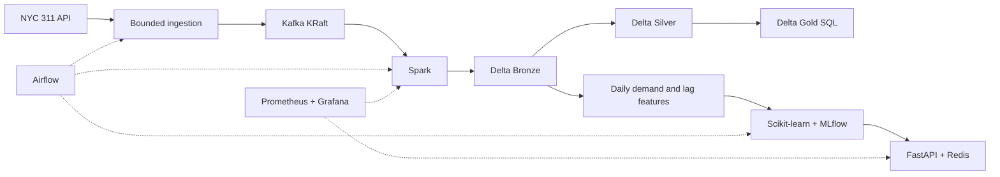

# UrbanLake

An urban-service lakehouse and demand-forecasting platform built with official NYC
311 data. It demonstrates bounded API ingestion, Kafka, Spark/Delta medallion
processing, SQL analytics, chronological ML evaluation, MLflow, FastAPI/Redis,
Airflow, and operational metrics on a Windows development machine.

**Local portfolio implementation; not production certified.** Source polling is
reconciliation, **not CDC**. The initial request analytics cover an explicitly
labeled 200-record sample. Forecasts use 120 complete citywide aggregate days.

See [architecture and decisions](docs/ARCHITECTURE.md),
[verification ledger](docs/VERIFICATION.md), and [build clock](docs/BUILD_LOG.md).

The separately authorized **23,008,706-record full-data extension** uses a new
partitioned pipeline and an independent lake under `data/full`. Its measured scope,
resume commands, resource budget and honest completion status are recorded in
[the full-data run ledger](docs/FULL_DATA_RUN.md). The initial sample audit remains
available as historical evidence.



The build used Python 3.12.10, Spark 4.0.1, Delta 4.0.0, Java 17, Kafka 4.0.1,
PostgreSQL 15.18, Airflow 2.11.0, Scikit-learn 1.7.1 and MLflow 3.2.0.
Kafka is built from an official Apache archive with a pinned SHA-512 checksum.
Redis is built from Debian's Redis 7.0 package. This avoids registry layer-download
failures encountered during the build. Prometheus uses its official Quay mirror.
Top-level Python versions and important compatibility dependencies are pinned;
this is not a complete transitive, hashed, multi-platform lockfile.

## Quick start (PowerShell)

Use the existing Python 3.12 environment, or create one with your Python 3.12
interpreter. The machine's default `python` may be a different version.

```powershell
cd C:\Projects\urbanlake
.\.venv\Scripts\python.exe --version
.\.venv\Scripts\python.exe -m pip install -e '.[dev]'
.\.venv\Scripts\python.exe -m pytest -q
.\.venv\Scripts\python.exe -m ruff check .
docker compose config --quiet
docker compose build kafka redis spark api
docker compose --profile pipeline up -d kafka kafka-init
```

Docker supplies Java/Spark; no host Java installation is required. Builds download
runtime dependencies, including approximately 434 MB for PySpark, but do not
download the source dataset. No GitHub push or external deployment is performed.

## Reproduce the bounded source workflow

The following fixed window reproduced the build. Source data can be revised, so
future results can differ. It deliberately excludes November 1, the source's
latest and possibly incomplete day observed during the build.

```powershell
.\.venv\Scripts\python.exe scripts/probe_source.py
.\.venv\Scripts\urbanlake.exe ingest --kind daily_demand --start 2026-07-04 --end 2026-11-01 --run-id demand-bootstrap-20261103 --output data/samples/demand.jsonl
.\.venv\Scripts\urbanlake.exe ingest --kind request --start 2026-10-31 --end 2026-11-01 --sample-limit 200 --run-id requests-sample-20261103 --output data/samples/requests.jsonl
.\.venv\Scripts\python.exe scripts/replay.py data/samples/demand.jsonl data/samples/requests.jsonl
docker compose run --rm spark process
```

Without `--output`, ingestion publishes directly to Kafka. JSONL output is an
optional observation archive for reproducible replay. Files append rather than
overwrite; replay duplicates are deduplicated in Bronze. Use a new run ID for a
new logical poll, and preserve archived observations for exact replay.

Date windows are `[start, end)` in NYC local calendar time. A normal request
ingestion must finish the window: exceeding `--max-records` fails and leaves no
successful completion manifest. Split oversized windows before retrying.
`--sample-limit` explicitly opts into incomplete request coverage; its manifest
records `complete=false`. Do not use request-sample counts as citywide statistics.
The API aggregate path checks day coverage and excludes the latest source day;
older upstream data can still be revised or incomplete.

`data/bronze/observations` preserves snapshots, `data/silver/requests` holds one
latest observed record per key, and `data/silver/observed_changes` records content
differences. `data/gold/daily_requests` contains grouped request analytics;
`daily_demand` and `daily_demand_features` contain citywide demand and lag features.
SQL definitions live in [sql](sql). See [recovery and coverage semantics](docs/ARCHITECTURE.md).

## Train and serve

Start ML services only when needed; wait for their actual healthchecks.

```powershell
docker compose --profile ml up -d --wait mlflow
docker compose run --rm train train
docker compose --profile serve up -d api
$model = Invoke-RestMethod http://localhost:8000/v1/model
$body = @{schema_version=1; target_date=$model.supported_target_date} | ConvertTo-Json
Invoke-RestMethod http://localhost:8000/v1/predictions/demand -Method Post -ContentType application/json -Body $body
Invoke-RestMethod http://localhost:8000/ready
```

Model training requires at least 60 contiguous completed days. Shifted lags and
rolling means prevent current-target leakage. A chronological validation tail
chooses random forest versus the seasonal-naive lag-seven baseline; a separate
22-day test tail in this build measured MAE **744.77** versus **889.77** requests/day.
Those are small-sample backtest results, not a guarantee of current model quality.
Historical source corrections remain a point-in-time evaluation limitation.

The build model has `as_of_date=2026-10-31` and only supports a forecast for
`2026-11-01`. The API exposes `source_stale` and `supported_target_date` and refuses
unsupported dates. Restart `api` after retraining (`docker compose restart api`).
Redis cache keys include the loaded model's hash; a Redis outage falls back to
direct inference. Load only trusted local model artifacts: joblib can execute code.

| Local service | Address |
|---|---|
| API docs | http://localhost:8000/docs |
| API health / readiness | http://localhost:8000/health / http://localhost:8000/ready |
| MLflow | http://localhost:5000 |
| Prometheus | http://localhost:9090 |
| Grafana dashboard | http://localhost:3000/d/urbanlake-operations |
| Airflow (optional) | http://localhost:8081 |

## Verification commands

```powershell
# Deterministic fixture: no NYC download, isolated Kafka topic/lake/checkpoints.
docker compose run --rm --entrypoint python -v ./scripts:/app/scripts:ro spark /app/scripts/integration.py
# Live-source assertions, including Gold/Python feature parity.
docker compose run --rm --entrypoint python -v ./scripts:/app/scripts:ro spark /app/scripts/verify_lake.py
# Actual service integration (requires ML, serving, monitoring profiles).
docker compose --profile monitoring up -d pipeline-exporter prometheus grafana
.\.venv\Scripts\python.exe scripts/verify_services.py
```

The fixture verifies duplicate publication, a source correction, one observed
change, and a complete Kafka offset rewind against the same Delta tables. It also
checks malformed-message quarantine and model-ready feature counts. Evidence
reports are written under Git-ignored `artifacts/`. Fixture lakes/topics are
isolated and retained for diagnosis; topics expire their data after one hour.

GitHub Actions defines lint/unit checks and a separate Docker integration job.
CI is configured; it is not claimed to have run on GitHub until pushed and observed.
There is deliberately no automatic deployment: publishing requires authorization.

## Airflow and resource profiles

```powershell
docker compose build airflow
docker compose up -d --wait postgres
docker compose run --rm --no-deps airflow airflow db migrate
docker compose run --rm --no-deps airflow airflow dags list
# Requires Kafka, MLflow and the saved sample files from the earlier sections.
# Manually execute the saved-sample pipeline, with no online download:
docker compose run --rm --no-deps airflow airflow dags test urbanlake_saved_sample_smoke 2026-11-03
# Optional UI/scheduler (DAGs remain paused):
docker compose --profile orchestration up -d airflow
```

The daily reconciliation DAG polls three created-date days with a three-day
source delay, refreshes 120 demand aggregates, then processes and trains. The weekly
wider DAG revisits 14 days, capped at 20,000 records/day (280,000 maximum per run).
Both start paused. **Review the API/resource budget before enabling them.** Neither
provides true CDC, delete detection, nor updates outside its lookback.
Airflow standalone writes its generated local login under
`artifacts/airflow/standalone_admin_password.txt`; do not publish that file.

Profiles: `pipeline` (Kafka), `compute` (one-shot Spark), `ml` (PostgreSQL/MLflow),
`serve` (Redis/API), `monitoring`, `orchestration`, and `jobs`. Avoid starting every
profile simultaneously on a 16-GB laptop. Docker had about 8 GB available during
the build, with an unrelated Airflow project already running; it was left untouched.
Run Spark and Airflow smoke jobs sequentially. Stop only UrbanLake services when
finished; data volumes are preserved:

```powershell
docker compose stop airflow mlflow
docker compose --profile pipeline --profile ml --profile serve --profile monitoring --profile orchestration down
```

Do not remove volumes or checkpoints casually. Kafka retains seven days of data;
lost offsets fail loudly. A new broker/lake needs its own checkpoint. A single
medallion writer is required; retries recover derived layers from Bronze after
partial multi-table writes. Full rebuilds are a bounded-scale design and must
be replaced with affected-key/partition updates before full-dataset operation.

Production work still includes authentication/TLS, secret management, replicated
Kafka, object storage, source coverage manifests, incremental derived updates,
backup/restore drills, model monitoring, stronger data contracts, and load tests.
The [verification audit](docs/VERIFICATION.md) distinguishes implemented behavior
from configured components and lists the exact checks that actually ran.
