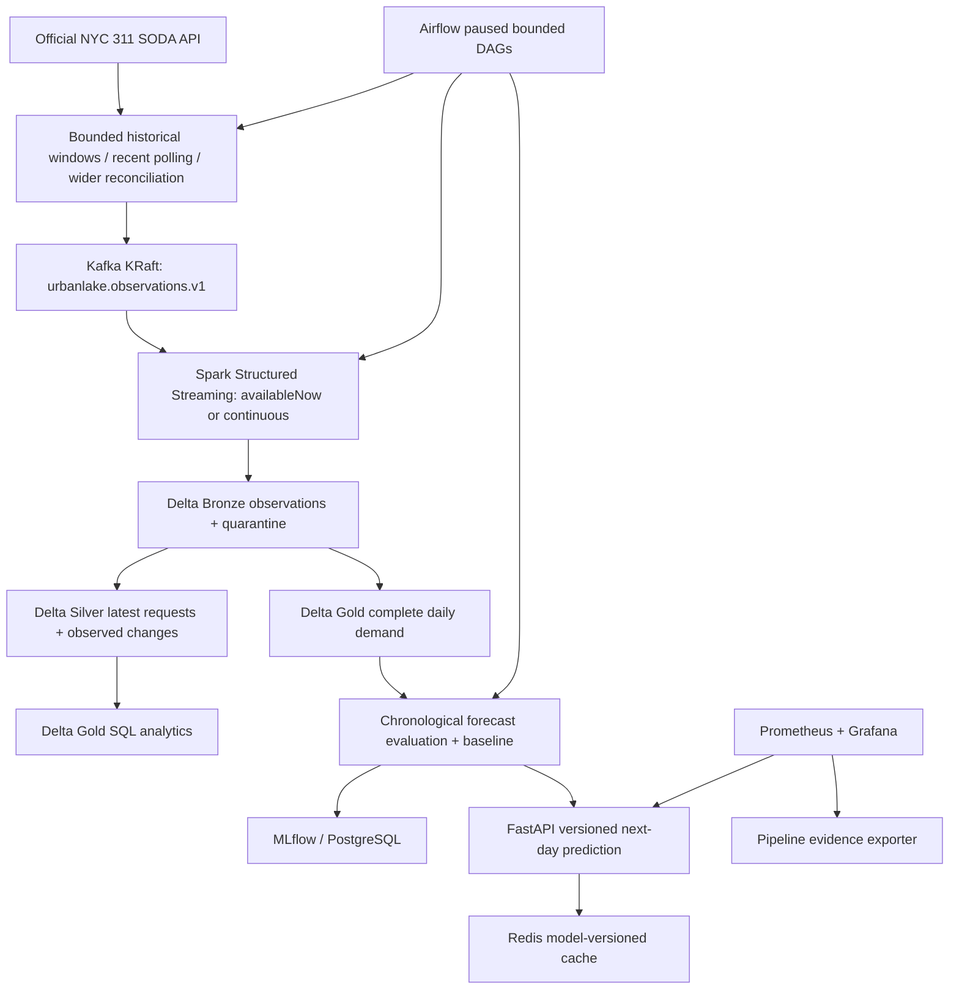

# UrbanLake design decisions

## Source semantics and coverage

The official dataset is [311 Service Requests from 2020 to Present](https://data.cityofnewyork.us/d/erm2-nwe9).
The API identifier is `erm2-nwe9`; this project does not assume coverage before 2020.
Source dates are NYC floating local times, whereas `observed_at` is an aware UTC
timestamp. Spark interprets source date strings in `America/New_York`.

There is no established row-level update timestamp. This is **snapshot polling
and reconciliation, not CDC**. The source can change during pagination; keyset
pagination prevents offset drift, but does not provide a database snapshot.
Rows moving to an earlier creation date, late additions, deletions, and changes
outside the configured lookbacks can be missed. No delete events are invented.

`unique_key` identifies a source request. A canonical SHA-256 content fingerprint
detects changes. Every polling run can preserve another observation even if the
content has not changed. An observation ID hashes run ID, kind, source key and
fingerprint: replaying the same observation is idempotent. Reusing a run ID is for
retrying one logical ingestion, not for unrelated polling runs.

`observed_changes` compares consecutive observed fingerprints. Its timestamp
means **we observed a difference**, not when the source changed or a service
transition happened. Intermediate source states may never have been observed.

CLI ingestion requires explicit start/end dates, limits individual windows to
366 days and request counts to 100,000. Pagination uses `(created_date, unique_key)`.
The cap throws an error instead of claiming a complete window. Initial 200-row
request ingestion is explicitly marked `coverage=bounded_sample`, `complete=false`.
Gold request totals therefore describe only ingested records and cannot be
presented as citywide backlog or complaint proportions. Citywide forecasting
uses a separate complete API aggregate query; it never trains on sample totals.

Daily aggregation requires contiguous unique days and excludes the latest source
day. This is a conservative completeness proxy, not proof of source finality:
upstream delays and retrospective revisions can still affect older days.
No missing date is silently filled with zero.

## Delivery, replay, and recovery

Kafka producers use idempotence and `acks=all`, and fail if any delivery fails.
Keys are `kind:source_key`; a request's messages share one partition.
The local broker has one replica, so `acks=all` is not high availability.
Default retention is seven days. Checkpoints preserve Spark offsets; loss of
retained offsets fails loudly through `failOnDataLoss=true`.

Spark parses the versioned envelope, checks required fields, schema version and
fingerprints, and quarantines invalid envelopes. Bronze uses Delta `MERGE` on
observation ID. Silver chooses the newest observed record per source key and
retains content-difference history derived from Bronze. Equal observation times
use a deterministic observation-ID tiebreaker; the source cannot establish a
true ordering of simultaneous contradictory snapshots.

This demonstration rebuilds derived Silver/Gold tables from Bronze. That is
simple and recoverable at bounded scale, but **not suitable for a 23-million-row
full-history refresh per microbatch**. Before scaling, incrementally MERGE affected
keys, recompute affected Gold partitions and persist quality/coverage manifests.
One writer is required. Separate Delta tables and CSV exports are not an atomic
multi-table transaction; retrying from Bronze repairs partial derived updates.
Kafka checkpoints must never be shared between independent lakes.

## Analytics and quality

Gold SQL groups volume by day, borough and complaint category; includes status-based
current unresolved counts, closure-date duration quantiles, closed requests without
closure dates, nonclosed requests with closure dates, and negative duration counts.
Invalid negative durations are excluded from duration quantiles rather than clipped.
The current status and closure date are both preserved; neither is a trustworthy
historical label by itself. Duration is a closure-date proxy, not a service SLA claim.
Raw source observations can include addresses/coordinates: local data and artifacts
are Git-ignored and should not be publicly uploaded without a privacy review.

## ML target audit

Seven-day unresolved classification is deferred: current snapshots cannot establish
the exact historical status at day seven. Closure dates conflict with statuses,
and current status/closure features would leak future information at request creation.
There is no defensible classification accuracy claim in this build.

Fallback: predict next calendar day's citywide request count. Inputs are count
lags 1/7/14, prior seven-day mean, target weekday/month. Every rolling feature
shifts before aggregation. Data must contain at least 60 complete contiguous days.
Evaluation is rolling **one day ahead**, using previously observed test-day counts
as they become available; it is not a multi-day fixed-origin forecast.

Chronological development/validation/test split: approximately 64/16/20 percent.
Validation MAE selects random forest versus a seasonal-naive lag-seven baseline.
The untouched test tail reports both; it does not select the model. The chosen
candidate is then refitted on all complete days for serving. MLflow records
metrics, date ranges, dataset hash, features, candidate model, and model card.
Reconstructed current aggregates are not historical point-in-time snapshots:
retrospective source corrections are a remaining backtest limitation.

The serving bundle stores 14 daily counts and an as-of date. It supports exactly
the next day after that as-of date. Missing/stale data never silently creates a
current-day forecast. Restart the API after retraining to load the new bundle.
Joblib is executable serialization and only trusted local artifacts may be loaded.

## Local operations and resource design

Profiles separate pipeline, compute, ML, serving, orchestration, monitoring and
one-shot jobs. The full stack is not intended to run together on a 16-GB laptop.
Airflow uses its own constrained virtual environment inside Docker so its dependencies
cannot replace application ML/Spark versions. Its DAGs start paused; recent polling
is three bounded created-date days, and weekly wider polling revisits 14 created-date
days (at most 280,000 records per run). Wider reconciliation starts paused and was
not run during this build; enabling it requires accepting that data/resource budget.
Changes outside the lookback remain undetected.
Training is orchestrated after processing, but API model reload is a deliberate restart.

Prometheus scrapes API latency/status/cache counters and actual pipeline counts,
quality failures, and last success time. Missing pipeline evidence is an explicit
signal. Alerts are evaluated locally; no external notification channel is configured.
Grafana panels query those metrics. Redis is an optional cache with a one-hour TTL;
keys include a hash of the loaded model bundle and requested date. Redis outages
fall back to direct inference. PostgreSQL stores MLflow and Airflow metadata in
separate databases, not source records.

Ports bind only to loopback. Kafka plaintext, local default passwords, standalone
Airflow, root application containers, and anonymous Grafana viewing are local
development choices. Production needs identity, secrets management, TLS, durable
object storage, a multi-broker design, backups, access controls, load testing and
operational ownership before deployment.

## Version references

- [Spark 4.0.1 runtime requirements](https://spark.apache.org/docs/4.0.1/index.html): Java 17/21, Scala 2.13, Python 3.9+.
- [Delta compatibility matrix](https://docs.delta.io/releases/): Delta 4.0.0 with Spark 4.0.x.
- [Airflow 2.11 prerequisites](https://airflow.apache.org/docs/apache-airflow/2.11.0/installation/prerequisites.html): Python 3.12 and PostgreSQL 15/16 supported.
- [Socrata bounded queries](https://dev.socrata.com/docs/queries/limit.html).

These are upstream compatibility declarations. Actual locally executed combinations
and limitations are recorded independently in `VERIFICATION.md`.
